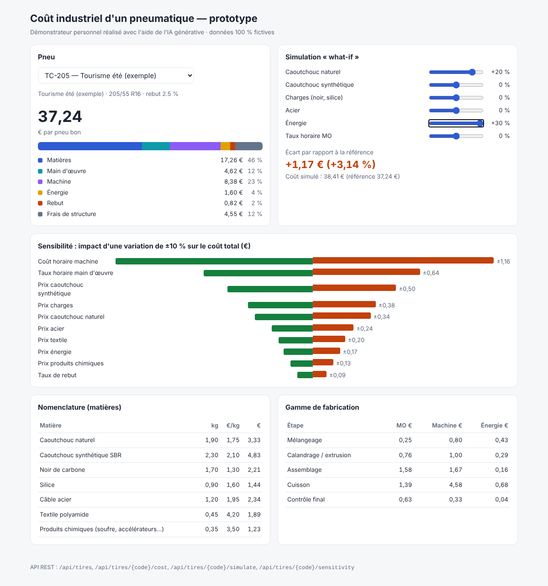

# Prototype — coût industriel d'un pneumatique

Démonstrateur personnel, réalisé en vue de ma candidature au stage
« Explorer l'IA générative pour moderniser une application R&D ».
Il reproduit à petite échelle la démarche décrite dans l'offre :
**user stories → tests → code → évaluation de l'apport de l'IA**.

> ⚠ Projet personnel, indépendant de toute entreprise. Toutes les données sont **fictives**.
> Je n'ai pas accès à l'application CRINET : les règles de calcul sont des hypothèses simplifiées.
> Code produit avec l'assistance de Claude Code ; voir le [journal de bord](docs/retour-experience.md).



## Fonctionnalités
- **Calculer** le coût d'un pneu : matières, main d'œuvre, machine, énergie, rebut, frais de structure
- **Simuler** des variations de prix (matières par famille, énergie, taux horaire)
- **Analyser** la sensibilité du coût à chaque inducteur (diagramme tornado)

## Documents
- [User stories et critères d'acceptation](docs/user-stories.md)
- [Stratégie de réécriture AI-assisted](docs/strategie-ai-assisted.md)
- [Journal de bord / retour d'expérience](docs/retour-experience.md)

## Lancer
Prérequis : Java 21, Maven.
```bash
mvn test                 # 17 tests
mvn spring-boot:run      # puis http://localhost:8080
```

## API
| Méthode | URL | Description |
|---|---|---|
| GET | `/api/tires` | Liste des pneus |
| GET | `/api/materials` | Référentiel matières |
| GET | `/api/tires/{code}/cost` | Décomposition du coût |
| POST | `/api/tires/{code}/simulate` | Simulation, ex. `{"materialPriceChange":{"NATURAL_RUBBER":0.1},"energyPriceChange":0.2}` |
| GET | `/api/tires/{code}/sensitivity?variation=0.10` | Analyse de sensibilité |

## Architecture
```
model/    records immuables + validation (TireSpec, BomLine, ProcessStep, Scenario…)
service/  CostCalculator (règles de calcul), SimulationService (what-if, sensibilité)
data/     SampleCatalog (données fictives en mémoire)
web/      TireController (REST) + static/index.html (interface)
```
