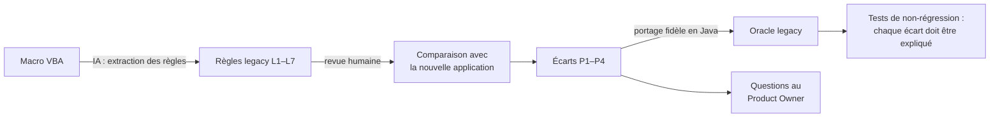

# Migration d'un outil legacy Excel/VBA

> Exercice sur un outil **fictif** ([`legacy/CalculCoutPneu.bas`](../legacy/CalculCoutPneu.bas)) qui reproduit
> la démarche de modernisation décrite dans l'offre : comprendre l'existant, extraire les règles,
> réécrire, et **prouver** que les écarts avec l'ancien outil sont maîtrisés.

## Démarche

## 1. Règles extraites de la macro

| # | Règle legacy | Ligne VBA | Nouvelle application |
|---|---|---|---|
| L1 | Matières = Σ Round(kg × prix, 2) | `mat = mat + Round(...)` | Σ kg × prix, arrondi en sortie seulement |
| L2 | MO = Σ Round(tps/60 × taux MO × nb opérateurs, 2) | `mo = mo + Round(...)` | idem, sans arrondi intermédiaire |
| L3 | Machine = Σ Round(tps/60 × taux machine, 2) | `mach = mach + Round(...)` | idem, sans arrondi intermédiaire |
| L4 | Énergie = Σ Round(kWh × 0,18, 2), prix **codé en dur** | `Const PRIX_KWH` | prix paramétrable (`CostParameters`) |
| L5 | Rebut = Round(direct × r, 2) | `rebut = Round(direct * txRebut, 2)` | direct × r / (1 − r) |
| L6 | Frais de structure = Round(MO × 35 %, 2) | `frais = Round(mo * TX_FRAIS, 2)` | 35 % × (MO + machine) |
| L7 | Matière introuvable → prix 0, sans message | `On Error Resume Next` | refus explicite (`UnknownMaterialException`) |

## 2. Les quatre pièges

| Piège | Pourquoi c'est un piège | Risque si on migre « tel quel » ou si on l'ignore |
|---|---|---|
| **P1 Arrondi bancaire** | `Round()` en VBA arrondit au pair : `Round(0.125, 2) = 0.12`. Java `HALF_UP` donne 0.13. En plus, le legacy arrondit chaque ligne. | Écarts de quelques centimes, difficiles à expliquer aux utilisateurs |
| **P2 Formule du rebut** | `direct × r` sous-estime le coût : pour produire 1 pneu bon, il faut en fabriquer 1/(1 − r). | Coût sous-estimé, faible ici (≈ 0,02–0,07 €) mais croissant avec le taux de rebut |
| **P3 Assiette des frais de structure** | Frais calculés sur la MO seule depuis 2016. Est-ce une décision du contrôle de gestion ou un oubli ? | **Écart principal : 7,5 à 8,7 % du coût total** |
| **P4 Erreur silencieuse** | `On Error Resume Next` : une matière absente du référentiel coûte 0 €, sans alerte. | Coût faux sans que personne ne le sache |

## 3. Résultat de la comparaison (données fictives)

| Pneu | Legacy | Nouvelle appli | Écart | dont P2 rebut | dont P3 frais | Écart % |
|---|---:|---:|---:|---:|---:|---:|
| TC-205 | 34,25 € | 37,24 € | +2,99 € | +0,02 € | +2,93 € | +8,7 % |
| SUV-235 | 45,36 € | 49,21 € | +3,85 € | +0,04 € | +3,82 € | +8,5 % |
| PL-315 | 176,59 € | 189,87 € | +13,28 € | +0,07 € | +13,20 € | +7,5 % |

Le reste (≤ 0,05 €) vient des arrondis (P1).

**Garde-fou automatique** : [`LegacyParityTest`](../src/test/java/com/agapova/crinetdemo/legacy/LegacyParityTest.java)
compare l'oracle legacy ([`LegacyCostPort`](../src/test/java/com/agapova/crinetdemo/legacy/LegacyCostPort.java), portage fidèle,
défauts compris) à la nouvelle application et échoue si un écart n'est pas expliqué par P1–P3.
Vérification : en modifiant volontairement une règle du portage, le test échoue bien.

## 4. Questions pour le Product Owner
1. **P3** : les frais de structure doivent-ils porter sur la MO seule (comme depuis 2016) ou sur MO + machine ?
   La réponse change le coût de ~8 %. Qui avait validé la règle de 2016 ?
2. **P2** : adopte-t-on la formule `r / (1 − r)` ? Faut-il l'expliquer aux utilisateurs habitués aux anciens chiffres ?
3. **P1** : quel niveau d'écart d'arrondi est acceptable pour valider la migration ?
4. **P4** : existe-t-il aujourd'hui des pneus calculés avec une matière manquante ? (à vérifier sur les données réelles)

## 5. Limite de l'exercice
La macro et son analyse ont été produites avec la même IA : l'extraction des règles ci-dessus
**démontre la méthode** mais ne mesure pas la capacité d'une IA à comprendre un code inconnu.
Cette mesure est l'objet de l'expérience décrite dans [`legacy/README.md`](../legacy/README.md).
Résultats : ChatGPT 3,5 / 4, Claude 4 / 4 (détail dans [retour-experience.md](retour-experience.md)).
